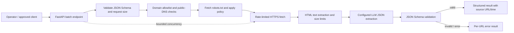

# Large-Scale Signal Scraper & Structured AI Extraction Engine

A permission-aware batch MVP that fetches operator-authorized HTTPS pages, respects each host's `robots.txt`, extracts visible text, and asks a configured OpenAI-compatible model for JSON validated against a caller-supplied schema.

## Workflow and architecture

## Current behavior and limits

- Accepts at most 20 URLs per request and four concurrent page workflows per process.
- Requires HTTPS and exact configured domains or their subdomains in `ALLOWED_DOMAINS`.
- Rejects IP-literal URLs and hostnames resolving to non-public addresses, does not follow redirects, and refuses pages disallowed by `robots.txt` or when robots policy cannot be checked.
- Rate-limits requests to each host and caps HTML at 2 MiB and extracted text at 30,000 characters.
- Sends page text as untrusted data to a configured model, requests JSON mode, and validates the returned object against Draft 2020-12 JSON Schema.

This is a bounded, in-process batch MVP, not a distributed large-scale queue. It has no authentication, durable job store, deduplication, scheduler, source-specific connector, or automatic retries. For Google Maps, job portals, and e-commerce platforms, use their documented APIs or licensed feeds where required; only configure sources whose terms and permissions allow collection. It does not bypass CAPTCHAs, authentication, paywalls, or rate controls.

## Quick start

See [`docs/DEPLOYMENT.md`](docs/DEPLOYMENT.md). Configure `ALLOWED_DOMAINS`, `LLM_EXTRACTOR_URL`, and `LLM_EXTRACTOR_MODEL`; provide `LLM_EXTRACTOR_API_KEY` when required.

## Data quality and privacy

Schema-valid output is not necessarily factually correct. Store source provenance and validate high-impact facts against the source or a human reviewer. Avoid collecting personal data unless the source, purpose, legal basis, and retention have been approved. Do not log page bodies or model prompts.
